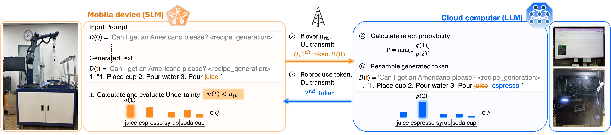
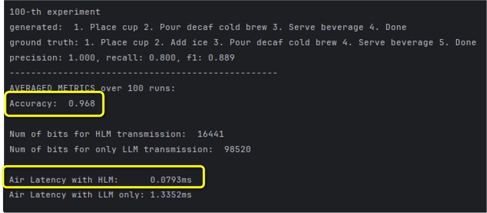

# Robot-Barista LLM: Uncertainty-Aware Edge–Cloud Language Model for Robotic Coffee Making
** LLM · Digital Twin · Speculative Decoding **


This is an independent robotic-barista demonstration that **draws on and adapts concepts from** *Uncertainty-Aware Opportunistic Hybrid Language Model in Wireless Robotic Systems*. It is not presented as the official source code or reproduction package of that paper.

---

## Overview

This repository demonstrates a **communication-assisted, collaborative language-generation framework** for a text-controlled robotic barista. Given a customer's natural-language coffee order, language models generate a task plan for the robot to execute.

The robot-side edge server has limited computing resources and cannot efficiently run a high-capacity language model. To address this limitation, the demonstration distributes generation between a locally deployed **small language model (SLM)** and a remote **large language model (LLM)**. The SLM produces candidate outputs, while uncertainty-aware communication selectively invokes the remote LLM to verify or refine them using a speculative-decoding-inspired procedure. The refined result is returned to the robot-side server for downstream task execution.


<h2>System Architecture</h2>
<p align="center">
  
</p>

1. **Customer order:** A user submits a text-based coffee order.
2. **Local generation:** The robot-side SLM generates candidate instructions or task-plan tokens.
3. **Uncertainty assessment:** The edge server evaluates the reliability of local generation.
4. **Selective edge–cloud collaboration:** When the uncertainty-based decision rule calls for remote assistance, relevant draft information is transmitted to the cloud LLM; otherwise, the local result is retained without unnecessary communication.
5. **Remote verification and refinement:** The cloud LLM verifies and, when needed, corrects the draft using a speculative-decoding-inspired procedure.
6. **Robot-side execution:** The resulting instructions are returned to the robot edge server for use in the coffee-making workflow.

The aim is to balance **task-generation quality, edge computation, communication overhead, and response latency** in a real-world robotic application.


```text
 Customer: Natural-language coffee order
                   |
                   v
       Robot-side Edge Server
       +--------------------+
       | Fine-tuned SLM     |
       | Draft generation   |
       | Uncertainty check  |
       +--------------------+
             |         ^
       selective       | refined / verified
       uplink          | generation
             v         |
       Remote Cloud Server
       +--------------------+
       | Fine-tuned LLM     |
       | Draft verification |
       | and refinement     |
       +--------------------+
                   |
                   v
       Robot task-plan execution
```

**Note:** In uncertainty-aware opportunistic inference, *low* uncertainty generally allows local generation to proceed without remote verification; *high* uncertainty triggers cloud assistance. The exact uncertainty measure, threshold, and transmitted payload should be checked against the implementation and configuration files.

## Language Models and Training

Both the edge SLM and cloud LLM were **trained or fine-tuned for the robotic coffee-order task**, and task-related training data are shared in this repository.

| Component | Role | Model architecture / checkpoint | Parameters | Training details |
| --- | --- | --- | --- | --- |
| Edge SLM | Resource-efficient local draft generation and uncertainty estimation | **To be verified from `training/` and model configuration** | **To be verified** | Task-specific training/fine-tuning; optimizer, dataset split, epochs, and context length to be documented from scripts |
| Cloud LLM | Remote verification, correction, and refinement | **To be verified from `training/` and model configuration** | **To be verified** | Task-specific training/fine-tuning; optimizer, dataset split, epochs, and context length to be documented from scripts |

Model names, parameter counts, and hardware specifications have deliberately not been guessed. They should be filled in from the actual training scripts, checkpoints, or configuration files before publishing the README as a verified technical specification.

<h2>Implementation results</h2>

<p align="center">
  
</p>

## Repository Structure

```text
Robot-Barista_LLM/
├── docs/                 # Project documentation
├── evaluation_data/      # Evaluation resources
├── mega_coffee_data/     # Coffee-order/task-related data
├── src/                  # Application and inference source code
├── training/             # Model training and fine-tuning resources
├── coding_test.py        # Supporting script
├── requirements.txt      # Python dependencies
├── requirements.lock     # Locked dependency versions
├── sample_input.txt      # Sample input
├── skip_config.json      # Uncertainty/skipping configuration
├── skip_config_new.json  # Alternative configuration
└── README.md
```

## Getting Started

Clone the repository and install its declared dependencies:

```bash
git clone https://github.com/NamHyelin/Robot-Barista_LLM.git
cd Robot-Barista_LLM
python -m venv .venv
source .venv/bin/activate  # macOS / Linux
pip install -r requirements.txt
```

The precise commands for starting the edge server, cloud server, and robot interface depend on the entry-point scripts and network settings under `src/`. **These commands have not yet been verified** and should be documented after inspecting those files. Likewise, model checkpoint locations, server addresses, and robot-control dependencies should be configured for the deployment environment rather than committed as secrets.

## Data

The repository shares task-related resources for model training and evaluation, including `mega_coffee_data/` and `evaluation_data/`. Refer to the individual files for their exact schema and intended usage. Before reuse or redistribution, verify the provenance and licensing of any third-party data, model weights, or assets.

## Research Inspiration and Citation

This project was implemented with reference to the uncertainty-aware edge–cloud language-model collaboration approach discussed in:

J. Park, Y. Lim, S. Oh, J. Park, J. Choi, and S.-L. Kim, **“Uncertainty-Aware Opportunistic Hybrid Language Model in Wireless Robotic Systems,”** *Machine Learning for Wireless Communication and Networks (ML4Wireless) Workshop at ICML*, 2025.

[Paper (OpenReview)](https://openreview.net/pdf?id=BfwuHrYUox)

The cited publication provides research inspiration; this repository is a separate application and demonstration, not an assertion of authorship of the publication or its official implementation.

## Copyright and Use

**Copyright © the respective authors of the referenced research and Hyelin Nam, for the materials to which each holds rights. All rights reserved unless otherwise stated.**

Authorship of the referenced paper does not automatically confer copyright ownership over this repository's independently written code, and vice versa. Third-party dependencies, datasets, model weights, and other assets remain subject to their respective licenses and rights. No open-source license is granted by this statement; contact the relevant rights holder(s) for permissions beyond those allowed by law or applicable component licenses.

